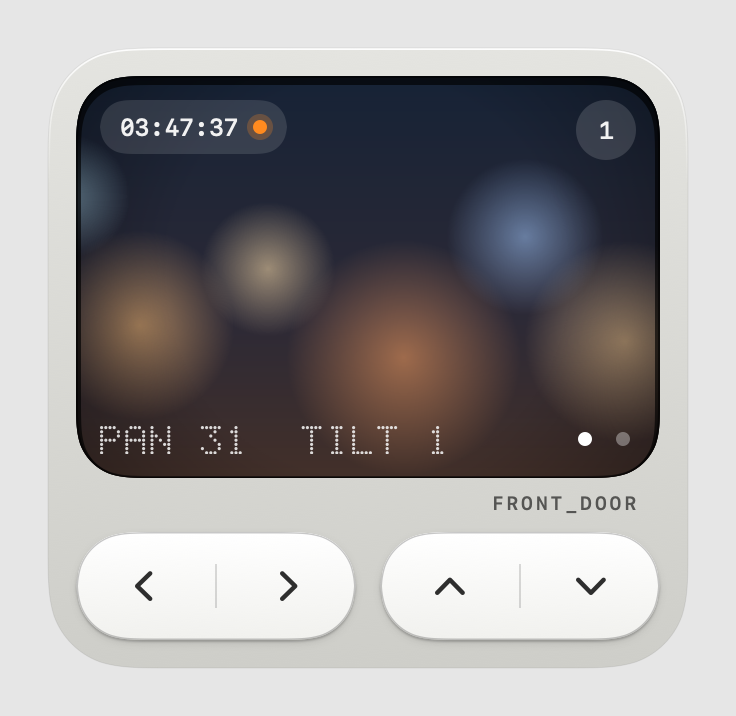
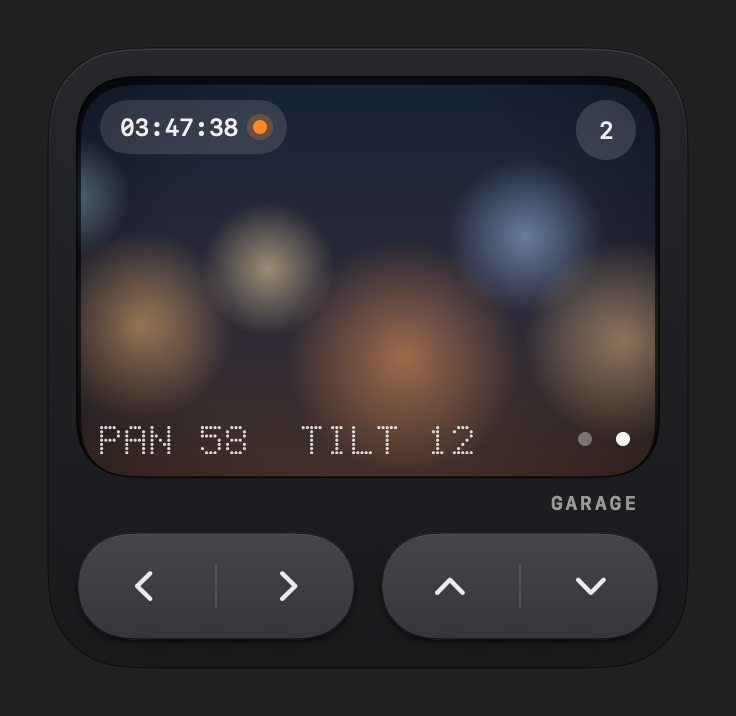

# Xiaomi Sentry

Your Xiaomi camera in a small window on your Mac desktop. Watch it and pan it without opening an app.

  
  

*Screenshots show a drawn placeholder picture, not a camera feed.*

## A camera window that stays

Click the menu bar icon to show the window and click it again to hide it. It floats above your other windows on every Space, including full-screen apps. Drag it anywhere, drag its corner to make the picture bigger, and it reopens where you left it with the camera you picked last.

## Pan and tilt

Hold a key or an arrow key to keep the camera moving. A tap is one step. Switch cameras with the round chip, the dots or the keys 1 to 9.

- **Native:** hardware HEVC decoding, no web view.
- **Local:** talks only to your go2rtc server. Your Xiaomi login stays in go2rtc and the go2rtc password stays in the macOS Keychain.
- **Out of the way:** lives in the menu bar and opens at login.

## Get started

Tested on **macOS 27, Apple Silicon**, with go2rtc 1.9.14.

| Guide | What's inside |
| --- | --- |
| [Setup](docs/setup.md) | Requirements, build and install, first run, adding cameras, signing and the Docker network setting |
| [Security](docs/security.md) | What the go2rtc password can do and the go2rtc settings that limit it |

**Pan and tilt need a patched go2rtc.** Video works with stock go2rtc 1.9.14, but the move command comes from `go2rtc-xiaomi-control` in [moguennouni/homebridge-xiaomi-go2rtc](https://github.com/moguennouni/homebridge-xiaomi-go2rtc). There is no sound yet, and the connection to go2rtc is plain HTTP on your home network.

## Credits

- [go2rtc](https://github.com/AlexxIT/go2rtc) by AlexxIT (MIT), which does the camera connection.
- The Xiaomi move command patch by [moguennouni](https://github.com/moguennouni/homebridge-xiaomi-go2rtc).
- This project is not affiliated with Xiaomi.

## License

[MIT](LICENSE).
