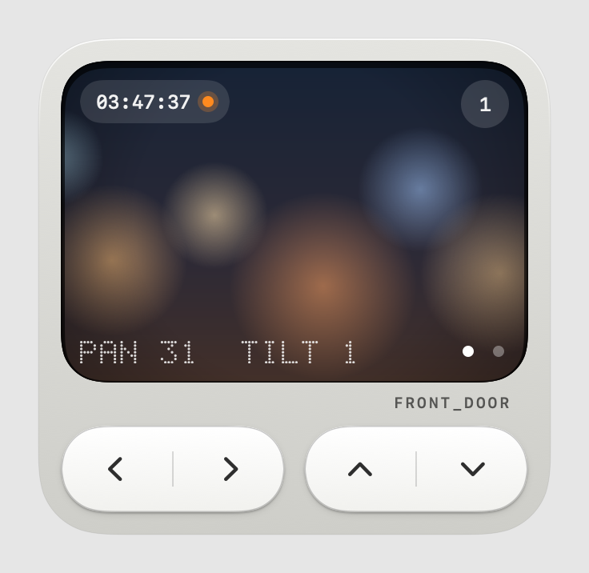
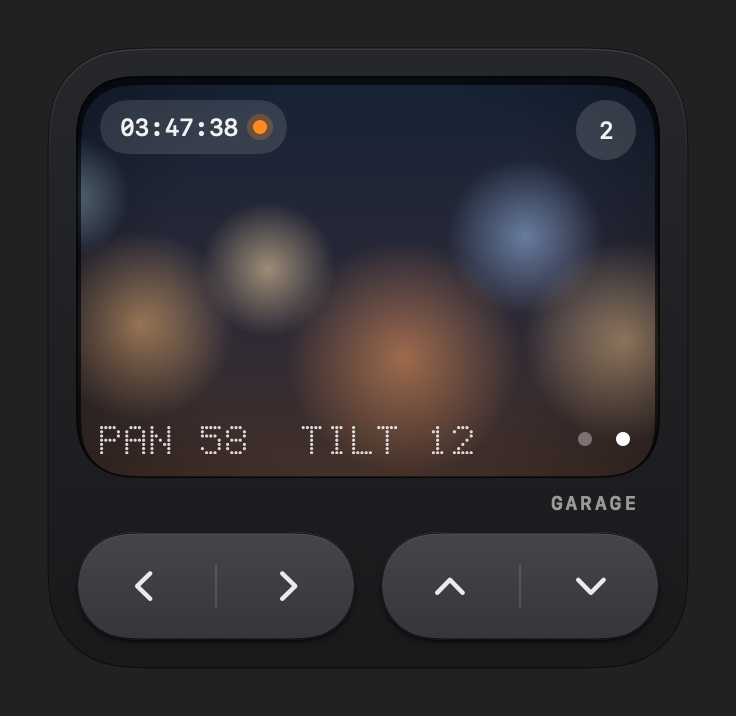

# Xiaomi Sentry

A small macOS menu bar app that shows a Xiaomi camera through [go2rtc](https://github.com/AlexxIT/go2rtc) and lets you pan and tilt it.

<p>
  
  
</p>

The screenshots show a drawn placeholder picture, not a camera feed.

## What it does

- Opens from a camera icon in the menu bar. Opening the app again (Finder, Spotlight) also opens the panel.
- Plays the camera natively: go2rtc's fMP4 stream over a WebSocket, decoded by the Mac's hardware HEVC decoder. No web view, no WebRTC.
- Pans and tilts. Hold a key or an arrow key to keep moving; a tap is one step.
- Remembers the last camera you picked and opens it next time.
- Light, dark or system appearance (right-click the icon).
- Opens at login: the app turns this on at first launch. Turn it off from the right-click menu.
- The go2rtc password lives in the macOS Keychain. Other settings (address, user, region, appearance, last camera, camera names) are in the app's preferences. Your Xiaomi login stays in go2rtc.

## Requirements

- macOS 15 or later (built and tested on macOS 27.2, Apple Silicon).
- To build: a Swift 6 toolchain (Xcode 16 or later). Built with Xcode 27.2.
- A go2rtc server on your LAN with Xiaomi support. Video works with go2rtc 1.9.14. Pan and tilt need the patched build `go2rtc-xiaomi-control` from [moguennouni/homebridge-xiaomi-go2rtc](https://github.com/moguennouni/homebridge-xiaomi-go2rtc), which adds `POST /api/xiaomi/command`.
- go2rtc with an API username and password.
- **If go2rtc runs in Docker, use `network_mode: host`.** The Xiaomi camera answers go2rtc's first UDP packet from a different port, and Docker's bridge NAT drops that reply. The symptom is `streams: read udp ...: i/o timeout` even though the camera answers ping.

## Build and run

```bash
scripts/build-app.sh --install
```

This builds `Xiaomi Sentry.app`, moves it to `/Applications` and starts it, so only one copy exists. Use `--open` instead to run it from `build/` without installing. It is signed with your Apple Development certificate if you have one, otherwise ad hoc; no paid developer account is needed. With ad hoc signing, macOS may ask for Local Network access again after a rebuild. A copy built on your own Mac opens without a Gatekeeper warning. A copy downloaded from elsewhere needs System Settings → Privacy & Security → Open Anyway once.

On first use macOS asks for Local Network access. Allow it, or the app cannot reach go2rtc.

## Use

1. Click the menu bar icon and enter the go2rtc address, port, API user and password. Use an IP address, a `.local` name or a one-word host name: macOS blocks plain HTTP to other host names.
2. If go2rtc has no camera streams yet, pick your Xiaomi region and press **Add from Xiaomi**. This creates one stream per camera in go2rtc's config. Log in to Xiaomi once in the go2rtc web page first.
3. Controls:
   - Left key: pan. Right key: tilt. Arrow keys work too. Hold to keep moving.
   - Round chip or dots: switch camera. Keys 1 to 9 also switch.
   - Right-click the icon: cameras, appearance, open at login, settings, reconnect, quit.
   - Esc or a click outside closes the panel.

The stream stays open for 60 seconds after you close the panel, so a quick reopen is instant.

## Security

Keep go2rtc on your home network. Do not forward its ports to the internet.

The app sends the go2rtc password as HTTP basic auth over plain HTTP, so anyone who can capture traffic on your Wi-Fi can read it. Optional go2rtc settings that reduce what that password can do:

```yaml
api:
  # Only the paths this app uses. This also hides /api/config, which shows the Xiaomi token.
  allow_paths: ["/api/streams", "/api/ws", "/api/xiaomi", "/api/xiaomi/command"]
  # Require the password from programs on the go2rtc host too.
  local_auth: true
  # Leave out origin: "*"; the app does not need it.
```

`allow_paths` also turns off the go2rtc web page. Add `"/"` and `"/api"` back for a moment when you need to log in to Xiaomi again.

## Limits

- No sound yet: the camera sends Opus audio, and this video path carries video only.
- Plain HTTP to go2rtc. go2rtc supports TLS, but the app does not use it yet.
- A new camera connection takes a few seconds: go2rtc fetches keys from the Xiaomi cloud and waits for a keyframe.

## Development

```bash
swift test                                        # demuxer, decoding and API tests
swift run XiaomiSentry --snapshot docs/screenshots  # regenerate the README screenshots (debug build)
```

`Sources/SentryCore` holds the go2rtc client, the fMP4 demuxer and the pan reply parser. `Sources/XiaomiSentry` is the menu bar app. Test fixtures are short, silent test patterns.

## License

MIT. See [LICENSE](LICENSE).
